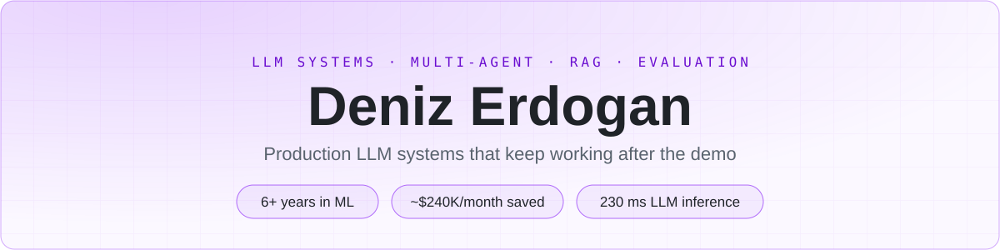

<!-- The head table: strip + banner -->
<table align = "center">
   <tr>
      <!-- Forward pass strip -->
      

         
      

   </tr>

   <!-- Banner: name card, dark and light variants -->
   <tr>
      

         <picture>
            <source media = "(prefers-color-scheme: dark)" srcset = "Materials/banner-dark.svg">
            
         </picture>
      

   </tr>
</table>

🧑‍💻 𝔸𝕓𝕠𝕦𝕥:
* Senior ML Engineer, based in Istanbul;
* 5+ years in commercial ML: LLM systems, AI agents, classic ML and the backend around them;
* BSc in Software Engineering;
* Studied at School 21 (42 Network);
* Now doing an MSc in AI & Big Data;
* Started out in open source, and GitHub is still where my own projects live;
* Outside work I solve problems on LeetCode;
* My name means "sea" in Turkish. Deep learning came naturally.

📬 ℂ𝕠𝕟𝕥𝕒𝕔𝕥𝕤:
* ML Profiles:  
* Reach Me:   

🧰 𝕊𝕥𝕒𝕔𝕜:

<!-- Stack table: one row per group -->
<table>
   <tr>
      <td><b>LLM&nbsp;Systems</b></td>
      <td>
         
         
         
         
         
         
         
         
         
         
         
         
         
      </td>
   </tr>
   <tr>
      <td><b>Evaluation</b></td>
      <td>
         
         
         
         
         
         
      </td>
   </tr>
   <tr>
      <td><b>Backend&nbsp;&amp;&nbsp;DevOps</b></td>
      <td>
         
         
         
         
         
         
         
         
         
         
         
      </td>
   </tr>
   <tr>
      <td><b>Data&nbsp;&amp;&nbsp;MLOps</b></td>
      <td>
         
         
         
         
         
         
         
      </td>
   </tr>
   <tr>
      <td><b>Deep&nbsp;Learning</b></td>
      <td>
         
         
         
      </td>
   </tr>
   <tr>
      <td><b>Graphics&nbsp;&amp;&nbsp;Desktop</b></td>
      <td>
         
         
         
         
         
         
      </td>
   </tr>
   <tr>
      <td><b>Languages</b></td>
      <td>
         
         
         
         
         
         
         
         
         
      </td>
   </tr>
   <tr>
      <td><b>ML&nbsp;&amp;&nbsp;Data</b></td>
      <td>
         
         
         
         
         
         
         
         
         
         
         
         
      </td>
   </tr>
   <tr>
      <td><b>NLP</b></td>
      <td>
         
         
         
      </td>
   </tr>
   <tr>
      <td><b>Observability</b></td>
      <td>
         
         
         
      </td>
   </tr>
   <tr>
      <td><b>Testing&nbsp;&amp;&nbsp;Quality</b></td>
      <td>
         
         
         
         
         
         
         
      </td>
   </tr>
   <tr>
      <td><b>Visualization</b></td>
      <td>
         
         
         
      </td>
   </tr>
   <tr>
      <td><b>Web</b></td>
      <td>
         
         
         
         
      </td>
   </tr>
</table>

<!-- GitHub activity heading: typing line -->

   

<!-- GitHub stats and streak -->
<table align = "center">
   <tr>
      <td width = "50%">
         
      </td>
      <td width = "50%">
         
      </td>
   </tr>
</table>

<!-- Trophies -->

   

<!-- Activity graph -->

   

<!-- Problem solving heading: typing line -->

   

<!-- LeetCode stats -->
<table align = "center">
   <tr>
      <td width = "100%" align = "center">
         
      </td>
   </tr>
</table>

<table align = "center">
   <tr>
      <!-- Forward pass strip -->
 

         
      

   </tr>
</table>
